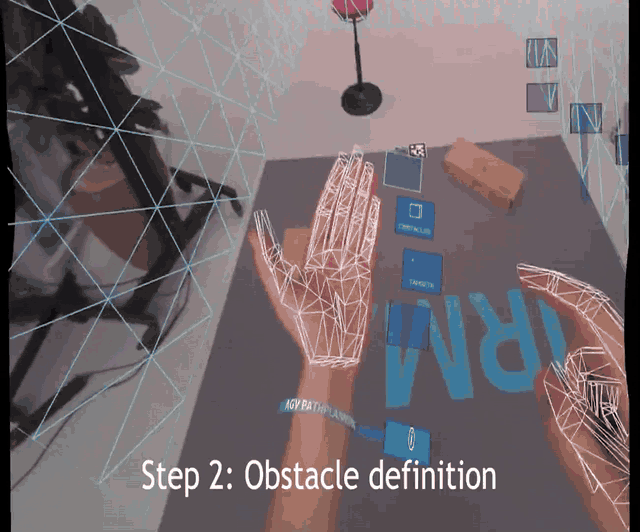

# AGV Path Planning in Mixed Reality

University team project, 2022-2023, written up as a bachelor thesis (Universidad de Alicante and University of Skövde). Co-developed with a teammate and presented individually at the University of Alicante; at Skövde it was a two-person project with equal shares. Republished from the team's original repository: https://github.com/alexmolera/AGV_PathPlanning_Final_MR. All commits there were made from a single account (alexmolera).



Short excerpt of the project's presentation video: obstacle definition with hand tracking.

Thesis: [University of Alicante repository (RUA)](https://rua.ua.es/dspace/handle/10045/135221).

> **This project will not open fully as published.** Third-party plugins, fonts, models, textures and sprites have been removed (see [Dependencies not included](#dependencies-not-included)). Scripts will not compile and scenes will show missing references until those dependencies are restored.

## What it is

A Mixed Reality application for creating, customising and exporting a simple AGV (automated guided vehicle) task using only hand gestures and a QR marker placed in the middle of a physical workspace. The user lays out a virtual floor, places obstacles, sets start and end points, and watches a virtual robot plan and drive the route.

## Why it is interesting

- **Path planning you set up with your hands.** Obstacles and targets are placed directly in the room, and the planner responds to that layout.
- **Two A* variants, side by side.** The user chooses Manhattan or diagonal movement.
- **Planning output leaves the headset.** Workspaces, waypoints and images are exported to files and can be plotted in a browser.

## Stack

- Unity 2020.3.17f1, C#
- Varjo XR plugin (mixed reality, marker tracking, depth occlusion)
- Ultraleap hand tracking and Interaction Engine, through Varjo's Unity modules
- Chart.js (loaded from a CDN) and Node `http-server` for the waypoint chart

## How it works

Scripts are in `Assets/AGV/Project Scripts`.

- **Flow.** `GlobalStateMachine` moves through four states: floor placing, object placing, target placing and simulating. Each state has a menu script (`BehaviourFloorMenu`, `BehaviorObjectMenu`, `BehaviourTargetMenu`, `BehaviourSimulationMenu`).
- **Grid (`Scripts Algorithm/Grid.cs`).** Builds a node grid from the floor's scale and marks blocked nodes with `Physics.CheckSphere` against a wall layer. A configurable `SafetyZone` inflates obstacles by extra nodes.
- **A* (`PathFindingManhattan.cs`, `PathFindingDiagonal.cs`).** Open and closed lists over the grid. The diagonal variant uses movement costs of 10 for straight and 14.14 for diagonal steps.
- **Smoothing and motion (`SmoothPath.cs`, `Line.cs`, `RobotMovement.cs`).** The node path becomes look-points with perpendicular turn-boundary lines. The robot follows them, slowing down near the end, and the covered distance is shown on screen.
- **Simulation feedback.** The interface shows calculation time, distance, and warnings when no path is found or a collision is detected. `Timer` tracks the run.
- **Data (`BehaviourDataMenu.cs`, `BehaviourImportData.cs`, `SnapshotCamera.cs`).** Exports the workspace and estimated waypoints as JSON and a top-down PNG snapshot to `Assets/StreamingAssets/ExportedData`. A saved workspace can be imported on the next run. Waypoints are plotted by the small page in `ExportedData/chartjs`, served through `http-server` on localhost.

The pathfinding code's structure and comments resemble publicly available A* tutorials; the repository does not record its sources.

## Results

The repository contains example output rather than a measured evaluation, so no performance figures are claimed. `Assets/StreamingAssets/ExportedData` holds:

- 2 example workspaces (`ExportedWorkspace/Example Cross.json`, `Example Difficult.json`)
- 8 estimated-waypoint exports (`EstimatedWaypoints/Program1-8.json`)
- 13 top-down snapshots of planned paths (`Snapshots/`)

## How to run

The project cannot be run from this snapshot alone. To attempt it:

1. Install Unity 2020.3.17f1 and clone this repository.
2. Restore the dependencies below. `Packages/manifest.json` fetches the Varjo plugin itself.
3. Run `npm install` for `http-server`. The export code starts it through `cmd.exe`, so this part is Windows-only.
4. Open `Assets/AGV/Scenes/Main AGV.unity`.

Running it for real needs a Varjo headset with hand tracking and a printed Varjo marker with ID 300 (https://developer.varjo.com/docs/get-started/varjo-markers). Removed assets may leave broken references even after these steps, because they rely on the GUIDs of the exact versions used.

## Dependencies not included

| Dependency | Original location | Where to get it |
|---|---|---|
| Varjo Ultraleap Unity modules (Varjo EULA) | `Assets/AGV/XR3-VR3-UnityModules-master` | Varjo developer site |
| `VarjoMarkerManager.cs` (appears adapted from a Varjo sample) | `Assets/AGV/Project Scripts` | Varjo marker documentation |
| TextMesh Pro resources | `Assets/AGV/Text Fonts` | Unity: TMP Essential Resources importer |
| Aovel Sans Rounded font (no licence in repo) | `Assets/AGV/Text Fonts/Fonts` | Source not recorded |
| CGHierarchyIcons (no licence in repo) | `Assets/AGV/Assets Adicionales` | Unity forum thread "Free Hierarchy Icon" |
| Wooden floor textures | `Assets/AGV/Materials/Materials/Wooden floor` | Source not recorded |
| Wireframe shader | `Assets/AGV/Materials/Materials/Wireframe` | Source not recorded |
| Electric Laser effect | `Assets/AGV/Objects/Electric Laser` | Source not recorded |
| 3D models, textures and sprite images of unknown or web origin | `Assets/AGV/Objects`, `Assets/AGV/Sprites` | Not available |
| Node modules | `node_modules` | `npm install` |

## Third-party code included

`Assets/AGV/Project Scripts/SimpleInteractionGlowSlider.cs` carries an Ultraleap, Inc. copyright header under Apache 2.0, kept in the file. It may have been modified by the team.

## Repository layout

```
Assets/AGV/Scenes                    Main scene
Assets/AGV/Project Scripts           Menus, state machine, data export
Assets/AGV/Project Scripts/Scripts Algorithm   Grid, A*, smoothing, robot motion
Assets/AGV/Materials, Objects, Sprites   Team materials, prefabs, animations (no images or meshes)
Assets/AGV/XR, XR Varjo              XR settings
Assets/StreamingAssets/ExportedData  Example outputs and the chart page
Packages, ProjectSettings            Unity configuration
```

## Team and credits

Team project; I worked across the whole implementation. Co-developed by Alejandro Rubio ([@alejandrorubioo](https://github.com/alejandrorubioo)) and [@alexmolera](https://github.com/alexmolera), with the work split evenly; presented individually at the University of Alicante. All commits in the original repository were made from a single account (alexmolera).

The project settings name it "ASSAR Thesis", referring to the [ASSAR Industrial Innovation Arena](https://assarinnovation.se/en/) in Skövde, Sweden. This repository is not published by or on behalf of ASSAR.

Rights remain with the authors; a licence is pending.
